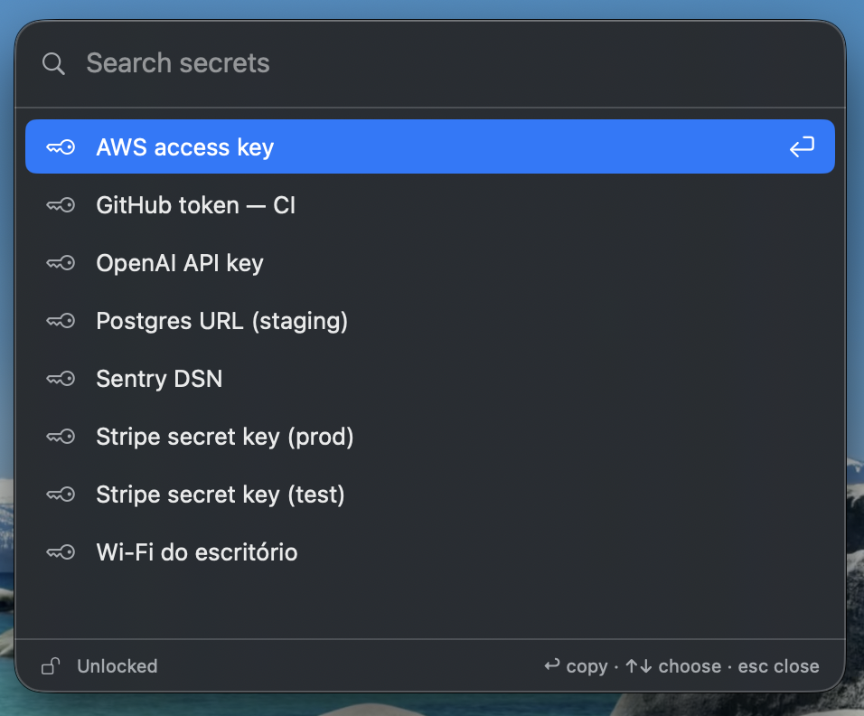
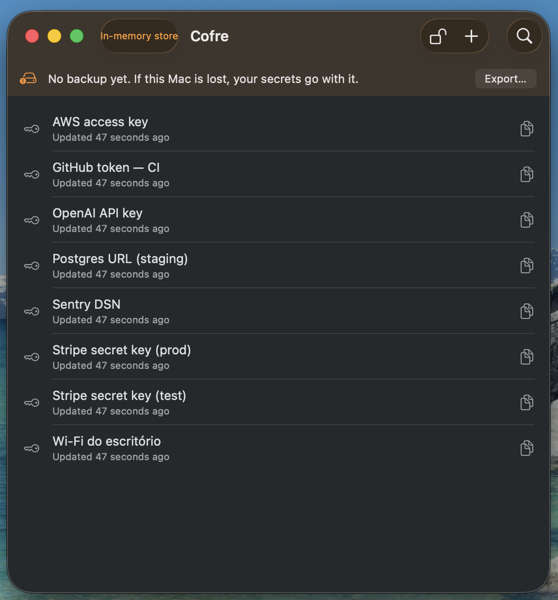
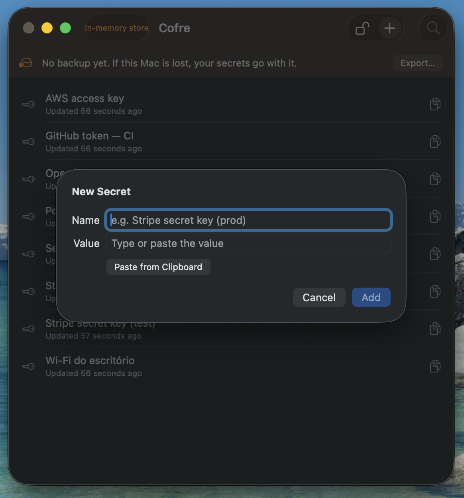
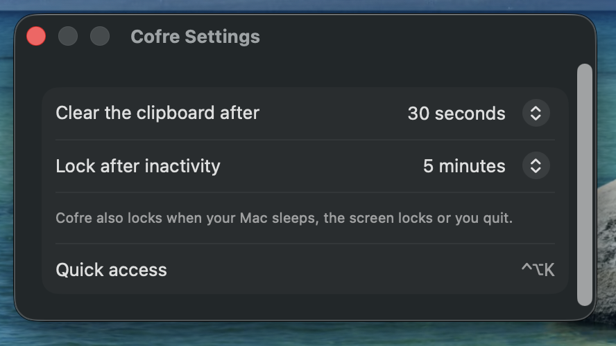

# Cofre

> *Your dev secrets, one keystroke away. Nothing leaves your Mac.*

A native macOS app for the passwords, API keys, tokens and connection strings you copy every day. Each item is a name and a value. The value is never shown: you paste it in once, and from then on you only copy it.

**Status:** early development. The app runs day to day against the real Keychain, with Touch ID; settings, the About window and release builds are still to come. See `ROADMAP.md`.

<table>
  <tr>
    <td></td>
    <td></td>
  </tr>
  <tr>
    <td align="center"><b>⌃⌥K from any app:</b> type, Enter, paste</td>
    <td align="center"><b>The main window:</b> names only, never values</td>
  </tr>
  <tr>
    <td></td>
    <td></td>
  </tr>
  <tr>
    <td align="center"><b>Adding a secret:</b> type it or paste it, once</td>
    <td align="center"><b>Settings:</b> clipboard clearing and auto-lock</td>
  </tr>
</table>

*Screenshots use made-up secrets.*

## How it works

- **Keychain, not a home-made database.** Every secret is an item in the macOS data protection Keychain, bound to this Mac (`ThisDeviceOnly`), never synced, and readable only after Touch ID or your Mac password.
- **No network.** The app is sandboxed without the network entitlement; check `Config/Cofre.entitlements`.
- **Quick copy.** A global hotkey (⌃⌥K) opens a search panel: type a few letters, press Enter. The clipboard is cleared 30 seconds later, and clipboard managers are told to skip it.
- **Encrypted backup.** Export everything to a `.cofre` file protected by a passphrase (PBKDF2 + AES-256-GCM, format in `docs/EXPORT_FORMAT.md`) and import it on another Mac.

## Build

Requirements: macOS 15+, Xcode 16+.

```sh
git clone https://github.com/allbdev/cofre.git && cd cofre
scripts/check.sh            # lint + tests + unsigned build
open Cofre.xcodeproj
```

To use the real Keychain the app must be signed with your team (a free Apple ID works): copy `Config/Local.xcconfig.example` to `Config/Local.xcconfig` and set `DEVELOPMENT_TEAM`. Without it, run the Debug build with the argument `-CofreStore memory` (secrets live only while the app runs; the scheme has it, switched off, under Run → Arguments).

### Install on your Mac

```sh
scripts/install.sh          # signed Release build → /Applications/Cofre.app
```

With a free Personal Team, Apple's provisioning profile lasts 7 days: when Cofre stops opening, run the script again. Your secrets survive reinstalls (the Keychain ties them to your team and the bundle ID, not to a build).

## Layout

| Path | What |
|---|---|
| `CofreKit/` | Swift package. `CofreKit`: the logic (store protocol, search, export format, import, clipboard and lock rules, `VaultModel`), tested with `swift test`. `CofreKeychain`: the Keychain store |
| `Cofre/` | The app: SwiftUI views and AppKit adapters (clipboard, global hotkey, floating panel) |
| `Config/` | Build settings, entitlements, `Info.plist` |
| `docs/EXPORT_FORMAT.md` | The backup file format, with a recipe to decrypt it without the app |
| `docs/screenshots/` | README screenshots, taken from the Debug build with `-CofreStore memory -CofreDemoData YES` |

## License

MIT
